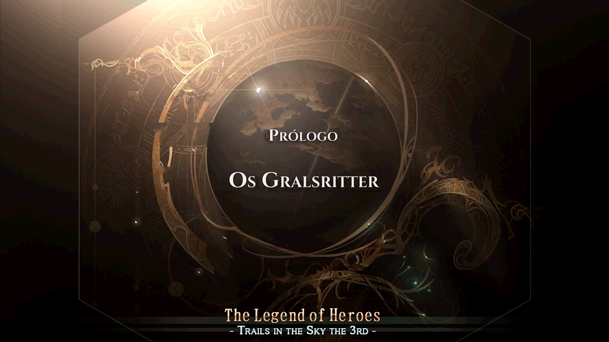
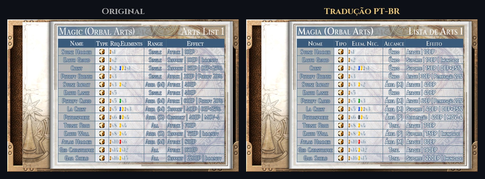
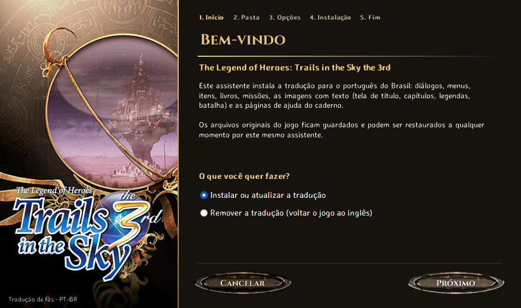
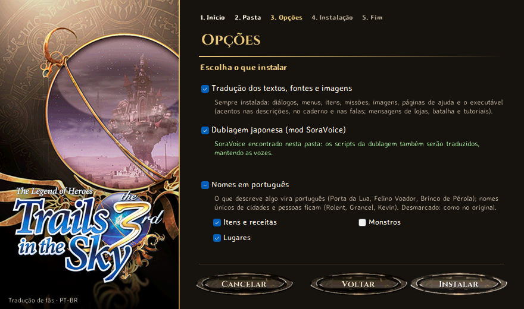
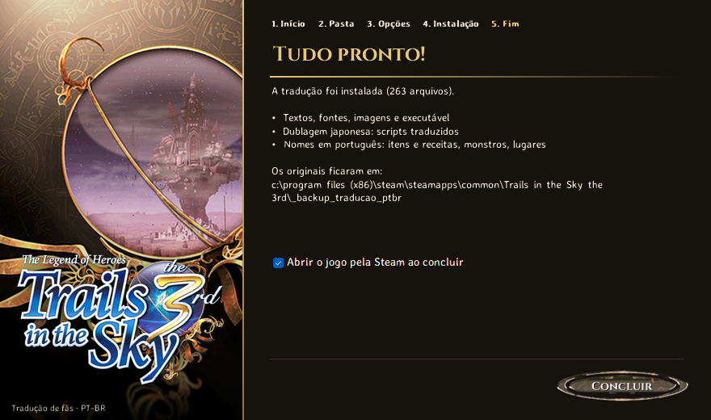

  

<h1 align="center">Trails in the Sky the 3rd — Tradução PT-BR</h1>

  Tradução de fãs para o português do Brasil da versão Steam de 
  <b>The Legend of Heroes: Trails in the Sky the 3rd</b>

  
  

  

---

## ✨ O que vem na tradução

|  |  |
|---|---|
| 💬 **Textos** | Diálogos, menus, itens, missões, livros, receitas, quizzes, descrições de artes e falas de batalha |
| 🔤 **Fontes** | Fontes do jogo com todos os acentos (á à â ã é ê í ó ô õ ú ü ç) e espaçamento certo |
| 🖼️ **Imagens** | Tela de título, cartões de capítulo, legendas das cenas, menus de batalha, "Carregando..." e as páginas de ajuda do caderno |
| ⚙️ **Executável** | Acentos nas janelas de descrição e no caderno; mensagens de lojas, batalha e tutoriais |
| 🎙️ **Dublagem japonesa** | Opcional: scripts do mod SoraVoice traduzidos, mantendo as vozes |

  

---

## 📥 Como instalar

1. Baixe o **`Trails3rd_PTBR_Instalador_v5.exe`** na página de [Releases](../../releases/latest).
2. Execute e siga o assistente. Ele acha o jogo sozinho na Steam (ou deixa você escolher a pasta).
3. Escolha as opções e clique em **Instalar**. Pronto: é só abrir o jogo pela Steam.

<table>
  <tr>
    <td align="center" width="33%"> <b>1.</b> Início</td>
    <td align="center" width="33%"> <b>2.</b> Opções</td>
    <td align="center" width="33%"> <b>3.</b> Pronto</td>
  </tr>
</table>

> [!NOTE]
> O instalador pede permissão de administrador porque a pasta da Steam fica em *Arquivos de Programas*.
> Os arquivos originais ficam guardados em `<pasta do jogo>\_backup_traducao_ptbr`.

### Opções

| Opção | O que faz |
|---|---|
| ✅ **Tradução dos textos, fontes e imagens** | Sempre instalada (inclui o executável traduzido). |
| 🎙️ **Dublagem japonesa (mod SoraVoice)** | Traduz os scripts da dublagem. Se a pasta ainda não tem o mod, o instalador coloca o [SoraVoice](https://github.com/ZhenjianYang/SoraVoice) Lite 20230823. As vozes em si (`voice\ogg`) não vêm junto. |
| 🏷️ **Nomes em português** | Dá para escolher por partes: **itens e receitas**, **monstros** e **lugares**. O que descreve algo vira português (*Porta da Lua*, *Felino Voador*, *Brinco de Pérola*, *Castelo de Grancel*); nomes únicos ficam (*Rolent*, *Grancel*, *Kevin*). |

Nomes de artes e crafts ficam sempre como no original.

---

## ❓ Perguntas frequentes

<b>Como mudo as opções depois?</b>

 
Rode o assistente de novo e marque o que quiser. O que for desmarcado volta ao original
(o mod SoraVoice posto pelo instalador também é removido).

<b>Como volto o jogo para o inglês?</b>

 
Rode o assistente e escolha <b>"Remover a tradução"</b>. Tudo volta a partir do backup.

<b>Conquistas e saves continuam funcionando?</b>

 
Sim. Conquistas, tempo de jogo e saves na nuvem da Steam funcionam normalmente. Áudio e vídeo não são alterados.

<b>Já uso o SoraVoice. Ele é substituído?</b>

 
Não. Se a pasta já tem o mod, o instalador só traduz os scripts da dublagem e não toca no seu mod.
Se ele estiver lá e a opção da dublagem ficar desmarcada, as falas aparecem em inglês, porque os scripts do mod substituem os do jogo.

<b>O que fica como no original?</b>

 
Nomes de personagens, de artes e crafts, logotipos, cartazes dos minigames e as capturas de tela dentro das páginas de ajuda.

---

## 🙏 Créditos

- **[SoraVoice](https://github.com/ZhenjianYang/SoraVoice)** de ZhenjianYang (GPLv3), incluído para a dublagem japonesa.
- Fontes [Cinzel](https://fonts.google.com/specimen/Cinzel) e [Averia Sans Libre](https://fonts.google.com/specimen/Averia+Sans+Libre) (SIL Open Font License), usadas no instalador e nas imagens.

Tradução feita por fãs, sem ligação com a Nihon Falcom ou a XSEED Games. É preciso ter o jogo original na Steam.
The Legend of Heroes e Trails in the Sky são marcas da Nihon Falcom Corporation.
